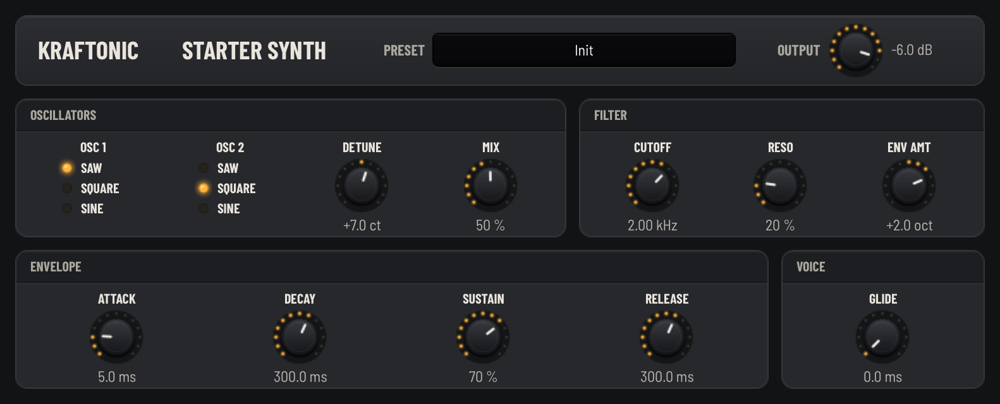

# Kraftonic Studio

An open DSP kit for building VST3 and CLAP synths and effects in C++20 (Windows, macOS and Linux), with an Audio Unit of each plug-in on macOS: real-time-safe DSP modules, the plug-in format layer, a panel kit and two small starter plug-ins to copy. MIT-licensed, so you can use it in free and commercial plug-ins alike.



New to DSP, sound design or plug-ins? Start with [docs/GUIDE.md](docs/GUIDE.md).

## Make your own plug-in in four steps

```sh
# 1. Fork this repository on GitHub, then clone your fork
git clone https://github.com/<you>/studio && cd studio

# 2. Copy a starter: an instrument (--from synth) or an effect (--from effect)
scripts/new-product.sh "My Synth" --from synth --vendor "Your Name"

# 3. Build
cmake -S . -B build -G Ninja -DCMAKE_BUILD_TYPE=Release
cmake --build build

# 4. Copy build/VST3/Release/MySynth.vst3 to your VST3 folder and load it in your DAW
#    (MySynth.clap next to it is the CLAP plug-in; on macOS MySynth.component is the
#    Audio Unit for Logic Pro and GarageBand)
```

`new-product.sh` copies the starter to `plugins/mysynth`, renames every file, class and display name, and gives your plug-in new IDs, so it never clashes with the starter in a DAW (`--dry-run` shows the plan first). Then open `plugins/mysynth/README.md` ("What to change first") and start changing the sound in `plugins/mysynth/dsp/`.

Name it, sell it, change anything: the code is MIT. Just don't call it "Kraftonic" ([TRADEMARKS.md](TRADEMARKS.md)); "built with Kraftonic Studio" is welcome.

## What's in the kit

| Module | What it gives you |
|---|---|
| `modules/core` | Parameter tables, instrument I/O and events, ADSR, smoothers, voice allocation, filters, peak protection |
| `modules/synth` | Band-limited oscillators, filters, modulation, noise, note priority |
| `modules/fx` | Drive, EQ, chorus, phaser, delay and reverb, behind one `StereoEffect` contract |
| `modules/sampler` | WAV loading, sample banks and a real-time sample player |
| `modules/piano` | Modelled electric and acoustic piano voices and a sampled-grand layer |
| `modules/wavetable` | A 16-voice wavetable synth engine |
| `modules/formats` | The plug-in formats, generated from a plug-in's traits: state, presets, parameters and MIDI shared by all formats; a VST3 and a CLAP adapter; on macOS an Audio Unit (AUv2) that wraps the VST3 |
| `modules/ui` | The panel kit: knobs, switches, menus and meters, plus a generator that writes a product's panel from its parameter table |

The two starters in `plugins/` are small, commented, fully tested plug-ins built on the kit:

| Product | What it is |
|---|---|
| **Kraftonic Starter Synth** | 8-voice synth: 2 oscillators, resonant low-pass, ADSR, glide |
| **Kraftonic Starter Effect** | Stereo drive into a delay with feedback, damping, ping-pong and mix |

## Test

```sh
ctest --test-dir build -R '^mysynth: '   # your plug-in's tests: pitch, filter, levels, state, presets
scripts/check.sh mysynth                 # build + tests + Steinberg validator + clap-validator (+ auval on macOS), in about a minute
```

The first configure downloads the pinned VST3 SDK, the CLAP headers and Catch2 (and Apple's AudioUnitSDK on macOS). Pass `-DKRAFTONIC_BUILD_PLUGINS=OFF` for a fast DSP-only build with no SDK. `scripts/check.sh mysynth --full` adds pluginval, which is slow; GitHub Actions runs it, and everything else, on macOS, Windows and Linux for every pull request. More in [docs/BUILDING.md](docs/BUILDING.md).

## Listen and look

- **Hear it:** load the plug-in in your DAW and play. Put any spectrum analyser or oscilloscope plug-in after it to see the waveform, the spectrum and the levels.
- **Without a DAW:** `build/bin/Release/mysynth_render out.wav` renders a short phrase per preset into one WAV and prints its peak and RMS; open it in any audio editor. The effect starter's render tool runs its presets over a test signal.

## Contributing

Bug reports, fixes, new modules and docs are welcome, from people and from people working with AI agents alike. Start with [CONTRIBUTING.md](CONTRIBUTING.md); the engineering rules (real-time audio, parameters, licensing) are in [AGENTS.md](AGENTS.md), and the design in [docs/ARCHITECTURE.md](docs/ARCHITECTURE.md) and [docs/SPEC.md](docs/SPEC.md).

## Licence

The code is under the [MIT License](LICENSE). The Kraftonic name and marks are trademarks of Khang Pham and aren't covered by it ([TRADEMARKS.md](TRADEMARKS.md)); brand assets are kept outside this repository. Third-party components keep their own licences ([THIRD_PARTY_NOTICES.md](THIRD_PARTY_NOTICES.md)).
