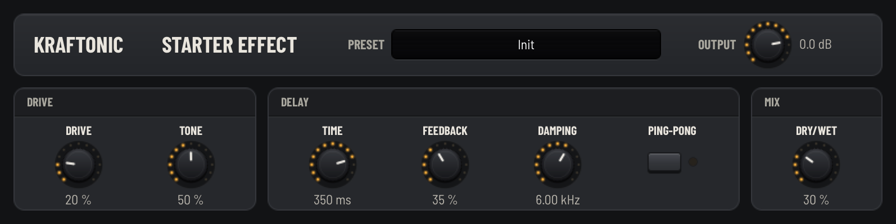

<!-- SPDX-License-Identifier: MIT -->
# Kraftonic Starter Effect

A small stereo drive-and-delay effect, and a template for your own effect.
A drive stage with a tone control feeds a delay with feedback, damping
(darker repeats), ping-pong and a dry/wet mix, then an output level. Zero
latency, click-free bypass, four factory presets.



## Make your own from it

```sh
scripts/new-product.sh "My Delay" --from effect --vendor "Your Name"
```

This copies this folder to `plugins/mydelay`, renames everything, gives the
copy new permanent plug-in IDs (VST3 class IDs, Audio Unit codes and the
bundle id, which is also the CLAP id) and
adds it to the build. Then read on.

## Install

After a build, copy `build/VST3/Release/KraftonicStarterEffect.vst3` to your VST3
folder. On macOS, also copy `KraftonicStarterEffect.component` from the same folder
to `~/Library/Audio/Plug-Ins/Components` for Logic Pro and GarageBand (Audio
Unit `aufx Stfx Kftc`). `KraftonicStarterEffect.clap`, also in that folder, is the CLAP plug-in
(id `com.kraftonic.startereffect`): copy it to your CLAP folder (`~/Library/Audio/Plug-Ins/CLAP`,
`C:\Program Files\Common Files\CLAP` or `~/.clap`).

## How it is put together

Data flows in one direction: **parameter table → engine → plug-in → panel**.

| File | What it does | Talks to the host? |
|---|---|---|
| `dsp/StarterEffectParameters.h` | The parameter table: id, key, name, unit, range, default, scale. The contract everything else reads. | no |
| `dsp/StarterEffectEngine.h`, `dsp/StarterEffectEngine.cpp` | The sound: maps the product's parameters onto two shared effects and processes audio in place. | no |
| `plugin/StarterEffectPresets.h` | Factory presets: plain values by parameter key. | no |
| `plugin/StarterEffectTraits.h` | Binds the table, engine and presets to the shared VST3 effect base, plus names, permanent IDs and the tail length. | no (SDK-free) |
| `plugin/StarterEffectValueText.h` | Parameter values as text ("350 ms", "6.00 kHz") and back. | no |
| `plugin/StarterEffectEntry.cpp` | The VST3 factory, a small controller subclass that turns off MIDI mapping (an effect takes no notes), and the CLAP entry. | yes |
| `ui/make_startereffect_uidesc.py` | The panel layout. Generates `startereffect.uidesc` and `startereffect.panel.json`. | — |
| `tests/` | Measured DSP tests, a realtime test, plug-in tests and a WAV renderer. | no |

What the shared kit does for you:

- **`modules/fx`**: ready effects with one shape (`prepare / reset / setParameters / process / latencySamples`, see `fx/Effect.h`): `Drive`, `Delay`, `Chorus`, `Phaser`, `Reverb`, `EQ`. Each smooths its own controls and crossfades on/off.
- **`modules/formats`** (`vst3/effect/`): the effect processor: stereo (or mono-in) buses, sample-accurate automation, latency-compensated click-free bypass, state and presets ([modules/formats/README.md](../../modules/formats/README.md)).
- **`modules/ui`**: the panel kit and generator ([modules/ui/README.md](../../modules/ui/README.md)).

### The engine in one paragraph

`setParameters()` fills an `fx::Drive::Parameters` and an
`fx::Delay::Parameters` from the product's plain values (drive 0 switches
the drive stage off, which the shared effect crossfades), and sets the
output level target. `process()` runs the drive, then the delay, in place on
the block, then ramps the output level. With drive and mix at zero the
output is bit-exact equal to the input (a test checks it).

## What to change first

1. **A parameter.** Add a row to the table in `StarterEffectParameters.h`
   (append the enum value before `count`), map it in
   `StarterEffectEngine::setParameters`, add a control in
   `ui/make_startereffect_uidesc.py` and run the script.
2. **The sound.** Swap or add shared effects: a `fx::Chorus` before the
   delay, a `fx::Reverb` after it. Each one is a member, a `prepare`, a
   `reset`, a `setParameters` and a `process` call. If you add one with
   latency, return the total from `latencySamples()`.
3. **The tail.** `tailSeconds()` in the traits tells hosts how long the
   effect rings after the input stops. Keep it matched to the sound.
4. **The names.** `kPluginName` and `kVendor` in the traits, the panel
   `title` in the generator. Your plug-in may not be called "Kraftonic"
   ([TRADEMARKS.md](../../TRADEMARKS.md)); `new-product.sh` handles this.

Rules that keep it a good plug-in (from [AGENTS.md](../../AGENTS.md)):

- Never allocate, lock, log or throw in `process`, `setParameters` or
  `reset`. Size buffers in `prepare`. The realtime test catches
  allocations.
- Smooth anything that can jump audibly. Output is always finite.
- Once a version ships, parameter ids and keys, the class IDs and the state
  magic are permanent: saved songs use them.

## Build, test, listen

```sh
cmake -S . -B build/check -G Ninja -DCMAKE_BUILD_TYPE=Release -DKRAFTONIC_WARNINGS_AS_ERRORS=ON
cmake --build build/check --target KraftonicStarterEffect startereffect_tests \
    startereffect_realtime startereffect_plugin_tests startereffect_render
ctest --test-dir build/check --output-on-failure -R '^(startereffect: |ui: startereffect panel$)'
# Listen: a plucked phrase through every preset; prints peak and RMS.
build/check/bin/Release/startereffect_render build/listening/startereffect.wav
# Panel: regenerate after changing the table or layout; snapshot it (macOS).
python3 plugins/startereffect/ui/make_startereffect_uidesc.py
build/check/bin/Release/kraftonic_editor_snapshot build/check/VST3/Release/KraftonicStarterEffect.vst3 \
    plugins/startereffect/screenshot.png
# Before a pull request:
scripts/check.sh startereffect
```

For quick DSP work without the VST3 SDK, configure `build/dsp` with
`-DKRAFTONIC_BUILD_PLUGINS=OFF` and build the three test targets.
